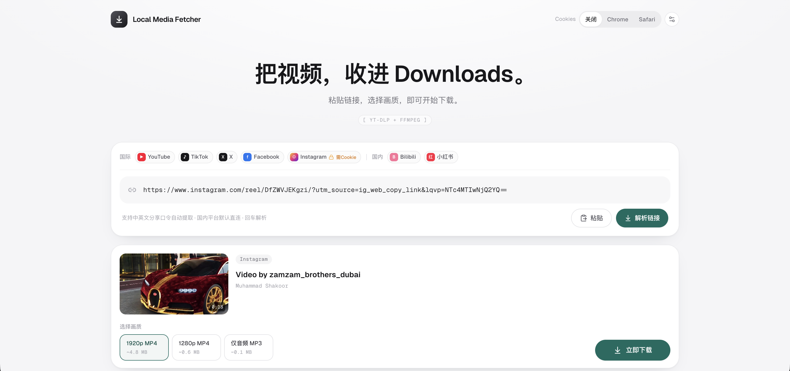

# Local Media Fetcher

基于 `Next.js`、`yt-dlp` 与 `ffmpeg` 的 macOS 本地多平台视频 / 音频下载控制台，所有文件直接落盘至 `~/Downloads`。



## 核心特性

- **统一入口，智能提取**：直接粘贴链接或混合分享口令（含中英文文案、Emoji、标点），自动提取纯净 URL；国内平台短链（`b23.tv`、`xhslink.com`）自动展开并规范化。
- **国内外自动网络分流**：无需手动切换模式，Bilibili / 小红书等国内站点默认强制直连（`--proxy ""`），避免海外代理触发地区限制或限速；可在 `/settings` 按需关闭。
- **浏览器 Cookie 接力**：支持一键选用本机 Chrome / Safari 登录态，解锁 Instagram 受限内容、Bilibili 1080p/4K 高清流等。
- **macOS 原生可播保障**：
  - B 站常见 `hev1` 封装 HEVC 流自动无损秒级重封装为 QuickTime 兼容的 `hvc1`；
  - VP9 / AV1 等编码优先使用 Apple Silicon **VideoToolbox 硬件加速**转码为 H.264，不可用时自动回退 `libx264`。
- **实时队列与本地管理**：SSE 实时推送下载进度、速率与剩余时间；支持取消、重试、防重复入队、重启后自动检测文件是否存在，以及一键在 Finder 中高亮定位文件。
- **个性化外观**：内置 14 套品牌强调色主题（`/settings`），首屏无闪烁恢复。

## 支持平台

| 区域 | 平台 | 说明 |
| :--- | :--- | :--- |
| **国际** | YouTube、TikTok、X、Facebook、Instagram | 公开内容免登录；Instagram 多数内容需开启浏览器 Cookie |
| **国内** | Bilibili、小红书 | 默认直连；Bilibili 未登录最高 480p，开启 Cookie 可解锁 1080p / 4K；小红书建议复制完整分享链接 |

> 页面顶部平台徽章支持直接点击跳转至对应平台官网。

## 环境要求

- **操作系统**：macOS（针对 Apple Silicon VideoToolbox 与 Finder 联动优化）
- **Node.js**：推荐 v20+
- **本地 CLI 依赖**：`yt-dlp`、`ffmpeg`（含 `ffprobe`）

```bash
brew install yt-dlp ffmpeg
```

## 快速开始

```bash
# 1. 安装依赖
npm install

# 2. 启动本地控制台（默认端口 3001）
npm run dev
```

启动后在浏览器访问：http://localhost:3001

## 浏览器 Cookie 使用说明

- **Chrome / Safari 接力**：在页面右上角「Cookies」切换即可；请确保目标平台已在所选浏览器的**普通窗口**（非无痕/访客模式）登录。
- **macOS 权限提示**：若提示无法读取浏览器 Cookie 数据库，请前往 **系统设置 → 隐私与安全性 → 完全磁盘访问权限**，为实际运行 `npm run dev` 的终端或 IDE 开启权限，完全退出（`Cmd + Q`）并重启服务后重试。

## 常用脚本

```bash
npm run dev     # 启动开发服务器（http://localhost:3001）
npm run build   # 生产构建与 TypeScript 类型校验
npm run start   # 启动生产服务
npm run lint    # ESLint 检查
npm test        # 离线回归测试（平台配置、URL 提取/规范化、代理分流、报错指引）
npm run smoke   # 真实链接冒烟巡检（仅解析不下载，需先启动 dev 服务）
```

> 使用 `npm run smoke` 前，可将 `scripts/smoke-urls.example.json` 复制为 `scripts/smoke-urls.local.json`（已被 `.gitignore` 忽略）并填入个人测试链接；如需附带 Cookie，可执行 `SMOKE_COOKIE=chrome npm run smoke`。

## 项目结构

```text
src/
├── app/
│   ├── page.tsx                  # 主控制台（统一输入、媒体预览、SSE 队列与历史）
│   ├── settings/page.tsx         # 偏好设置（国内直连分流、14 套主题色）
│   └── api/
│       ├── health/route.ts       # yt-dlp / ffmpeg 环境自检
│       ├── parse/route.ts        # 链接规范化与元数据解析
│       ├── download/route.ts     # SSE 下载流、HEVC 重封装与 VideoToolbox 硬件转码
│       ├── file-status/route.ts  # ~/Downloads 文件存在性巡检
│       └── open-folder/route.ts  # Finder 高亮定位（限制在 ~/Downloads 内）
└── lib/
    ├── platforms.ts              # 统一平台注册表与 URL 提取
    ├── url-normalizer.ts         # 国内短链展开与 URL 规范化（含 SSRF 防护）
    ├── media.ts                  # 路径防护、代理参数与平台报错指引
    ├── theme.ts                  # 14 套主题色配置
    └── extractors/               # 解析与下载命令统一封装
```
